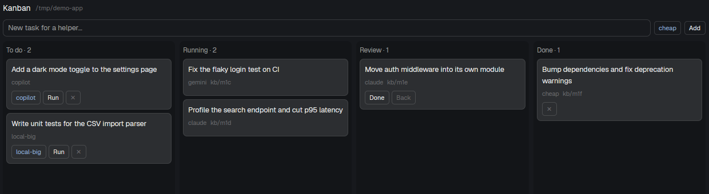

# herdr-kanban

A Kanban board for [Herdr](https://herdr.dev) that hands each card to a coding agent.




Write a task, pick an agent, and drag the card to **Running**. The board makes a git
worktree on its own branch, starts the agent there with `hc run`, and moves the card to
**Review** when the agent is done. Review the branch, merge it from the card, clean up.
Any `hc` template works: Claude Code, Gemini, Copilot, OpenCode on a local model,
whatever you have set up.

Inspired by [Vibe Kanban](https://github.com/BloopAI/vibe-kanban), but native to Herdr:
the agents are ordinary herdr-core terminals, so you can watch, steer or take over any of
them, and they follow your own `hc` templates instead of a separate agent setup.

## Install

Ask your agent in Herdr: *"add the herdr-mod from github.com/anakafeel/herdr-kanban"*.

Or by hand:

```sh
git clone https://github.com/anakafeel/herdr-kanban
cp -r herdr-kanban/mods/kanban ~/.config/herdr-app/mods/
herdr-app check ~/.config/herdr-app/mods/kanban
```

Then add the shortcut from [`keys.json`](keys.json) to your `~/.config/herdr-app/keys.json`
(`alt-shift-b` opens a board), and `.herdr/` to the `.gitignore` of repos you use it in.

## Use

Press `alt-shift-b`, or open a board for the repo of the focused terminal:

```sh
herdr-app do tab.new '{"mod":"kanban"}'
# or a specific repo:
herdr-app do tab.new '{"mod":"kanban","props":{"folder":"/path/to/repo"}}'
```

**Drag cards between columns.** While you drag, each column says what dropping there
does, or why it can't:

| From → To | To do | Running | Review | Done |
|---|---|---|---|---|
| **To do** | reorder (the run order) | start an agent, or queue it | refused: run it first | done without an agent |
| **Running** | stop the agent | | stop it and review its work | refused: still working |
| **Review** | back (same branch next time) | run again (or queue) on the same branch | | done |
| **Done** | reopen | refused: reopen first | reopen for review | |
| **Queued** (in Running) | take it out of the queue | reorder the queue | refused: it hasn't run yet | done without an agent |

Every move also has a button on the card:

| Column | Buttons |
|---|---|
| **To do** | template (cycles through `hc templates`), **Run** (or **Queue**), **Chain** (wait for the card above), **✕** |
| **Running** | **Open** (peek at the agent's terminal), **Stop**; queued cards: **Unqueue**, **✕** |
| **Review** | **Open**, **Merge into `<branch>`**, **Done**, **Back** |
| **Done** | **Clean up** (remove the worktree and branch), **✕** |

- **Running is a queue.** A card dropped on Running starts at once, unless it waits for
  other cards or every slot is taken: then it's queued ("queued · starts after …") and
  starts by itself as soon as it can, in queue order. **max running** in the header sets
  the slots (∞, 1 to 4), handy for a single local model or to cap parallel quota use.
- **Chained cards** show "waits for …" and start only once those cards are Done.
- **Merge** runs `git merge --no-ff` into the branch checked out in your repo. It refuses
  when that checkout has uncommitted changes, and on a conflict it aborts, so nothing is
  left half-merged.
- **Clean up** never forces: git keeps a worktree with uncommitted work and a branch that
  isn't merged, and the board tells you which.
- A card border in your theme's "blocked" color means its agent needs you.

Agents work in `<worktrees>/<repo>/kb-<id>` on branch `kb/<id>`. `<worktrees>` is Herdr's
`worktrees.directory` setting, `~/.herdr/worktrees` by default. The worktree branches from
your current commit, so commit first: the agent does not see uncommitted changes.

Cards live in `<repo>/.herdr/kanban.json` (`{"maxRunning"?: n, "cards": [{id, task, template, status, after?}]}`).
The board re-reads it every 3 s, so an orchestrating agent can plan work by writing cards
into it, with `after` for order. `herdr-app do kanban.run` starts (or queues) the first ready To-do card
on every open board, so keep one board per repo.

## What it runs

This mod runs programs on your machine: `git` (worktrees, `kb/<id>` branches, merges into
your checked-out branch), `mkdir`, `test` and `hc` (to start agents with your templates).
It writes `<repo>/.herdr/kanban.json` and worktrees under `<worktrees>`. It never reaches
the network itself.

**Anything that can write `.herdr/kanban.json` can queue tasks for your agents**, and a
card runs with whatever permissions its template has. If a template lets an agent run
commands without asking, a card in that file is a command on your machine once someone
starts it. Only start cards you read, and keep `.herdr/` out of shared or untrusted
checkouts. Card ids must match `[a-z0-9_-]{1,24}` and templates must exist in
`hc templates`; other cards are skipped.

## Develop

The board rules (parsing, merging, dependencies, columns, drag rules) live in
[`mods/kanban/logic.js`](mods/kanban/logic.js) with no Herdr calls, so they run under Node:

```sh
npm test
herdr-app check mods/kanban
```

## License

MIT
