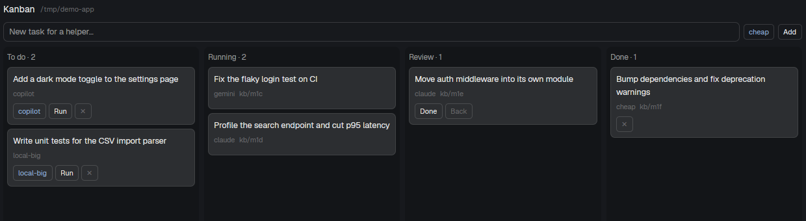

# Kanban

A board pane for one git repo. Each card is a task for a coding agent: pick an `hc`
template, press Run, and the agent works in its own git worktree while the card moves
from To do through Running to Review on its own. The person approves each start and
decides when a card is Done.

## What you see

Top to bottom, on `surface`, 10px padding, 8px gaps:

- **Header:** "Kanban" at 14px semibold, then the repo's root folder at 11px `dim`,
  truncated.
- **New card row:** a text input (flex, 30px tall, 8px side padding, 7px radius, 1px
  `input` border, `background` fill, 12.5px text, placeholder "New task for a helper…"),
  a small template button in `accent` text showing the template that new cards get,
  and an "Add" button.
- **Error line** (only when there is one): 11px `blocked` text ending in
  "(click to dismiss)".
- **Four equal columns** filling the rest, 8px apart: "To do", "Running", "Review",
  "Done". Each is a `canvas` panel, 8px radius, 6px padding, scrolling vertically, titled
  "<Name> · <count>" at 11.5px semibold `muted`.
- **Cards:** `raised` fill, 7px radius, 1px `border` outline, 8px padding. The task text
  at 12.5px; under it a 10.5px `dim` line: template, branch (`kb/<id>`) once started, and
  the agent's status word in that status's theme color. Below that, small buttons
  (11px, 1px `input` border, 5px radius, `hover` fill on hover).

## How it behaves

- **Add** (or Enter in the input) appends a To do card with the selected template.
  Clicking the header's template button cycles through `hc templates` in order.
- **To do card:** a template button (accent; cycles that card's template), **Run**, and
  **✕** (delete, `dim`).
- **Run:** the card goes to Running at once. In a git repo the mod runs
  `git worktree add -b kb/<id> <worktrees>/<repo>/kb-<id>` (`<worktrees>`: the
  `worktrees.directory` setting, default `~/.herdr/worktrees`), then
  `hc run --bg --json --name kb-<id> --cwd <worktree> <template> "<task>\n\nWork only in
  <worktree>. Commit your changes on the current branch when done."`, and stores the
  returned terminal address. Outside git it runs in the folder itself. A failure puts the
  card back in To do and shows the error as a line and a notification.
- **Running card:** status comes live from `terminals()` by the name `kb-<id>`.
  `working` shows in the working color; `blocked` turns the card border `blocked` and
  the word "needs you". **Open** (while the terminal lives) peeks at it
  (`terminal.peek`); **Stop** (`dim`) kills it and puts the card back in To do.
- **Review:** a running card shows here once its agent reports `done`, or `idle` after
  its first turn, or its terminal is gone; the 3 s timer saves that move. Buttons:
  **Open** (while the terminal lives), **Done** (kills the terminal, card to Done),
  **Back** (`dim`, kills the terminal, card to To do). Run again reuses the card's
  worktree, or its existing `kb/<id>` branch.
- **Done card:** only **✕**.
- The board re-reads its file every 3 s and redraws when another program changed it.
  `herdr-app do kanban.run` starts the oldest To do card.
- **Drag:** press a card and move it more than 5px to pick it up. The card fades to 35%,
  a 240px ghost (`raised`, `accent` border) follows the pointer, and every column shows
  what dropping there does: an `accent` border and label when allowed, a `blocked` border
  and the reason when refused, nothing when it's a no-op. Release to drop; leaving the
  board cancels. Dropping in To do lands above the hovered card (lower half: below it),
  since To do order is the run order. The rules (`dropAction` in `logic.js`):
  To do → Running starts it (refused while it waits for a card), → Review refused
  ("run it first"), → Done marks it done without an agent; Running → To do stops the
  agent, → Review stops it for review, → Done refused ("still working"); Review → To do
  back, → Running runs again on the same branch, → Done done; Done → To do reopens,
  → Review reopens for review, → Running refused ("reopen first").
- **Chain** (To do, not the first card): the card waits for the To do card above it
  (`after: [id]`) and shows "waits for: <task>" in `muted`; Run hides until those cards
  are Done. **Unchain** clears it.
- **Merge into <branch>** (Review, when the card has a branch): refuses if
  `git status --porcelain --untracked-files=no` is not empty; runs
  `git merge --no-ff --no-edit kb/<id>`; on failure `git merge --abort` and shows why. On
  success the card goes to Done, marked "merged" in `done` color.
- **Clean up** (Done, while it has a worktree or branch): `git worktree remove` then
  `git branch -d`, never forced; each refusal is shown and keeps what git kept.
- While a git action runs, the card's buttons are replaced by "working on git…".

## Built from

- One mod, `mods/kanban/` (`main.js`, `mod.json` with `"place": "none"`), opened as a tab
  or split: `tab.new {mod: "kanban", props: {folder?}}`. Without `props.folder` it uses
  `focused().cwd`, else the active space's folder, else `home()`.
- Repo root from `exec("git", ["rev-parse", "--show-toplevel"])`. Cards are stored in
  `<root>/.herdr/kanban.json` as `{"cards": [{id, task, template, status, terminal?,
  branch?, worktree?}]}`, where `status` is `todo | running | review | done` and `id` is
  `Date.now().toString(36)`.
- `herdr` calls: `exec`, `hc(["templates", "--json"])`, `hc(["run", ...])`,
  `readTextFile`, `writeTextFile` (with the last text read as `expected`), `terminals()`,
  `focused()`, `spaces()`, `home()`, `notify`, `nextCommand`, `checking`, `theme`, and
  `run("terminal.peek")` / `run("terminal.kill")`. `InputState` + `Input` from
  `gpui-base` for the input.
- Card ids must match `^[a-z0-9_-]{1,24}$` (hc's `--name` limit minus `kb-`); cards
  with a bad id, task or status are skipped with an error line. A template not in
  `hc templates` fails at Run.
- Programs run: `git`, `mkdir`, `test`, `hc`.
- Pure rules in `mods/kanban/logic.js` (no Herdr imports): `parseCards`, `mergeCards`,
  `waitingOn`, `isReady`, `columnFor`, `dropAction`, `applyDrop`, `nextOf`. Tested with
  `node --test` in `test/logic.test.js`.
- Drag is built from `on_mouse_down` on cards, `on_mouse_move` on the board, columns and
  cards (`local_position` and `bounds` for the half), `on_mouse_up` and `on_hover(false)`
  on the board, and an `absolute()` ghost; gpui-kit has no element drag and drop.
- `keys.json` binds `alt-shift-b` to `tab.new {mod: "kanban", name: "board"}`.

## Watch out

- Right after Run, `hc run` has not returned yet, so there is no terminal. Treat a
  running card with no stored address as still Running, or it jumps to Review at once.
- Saves must run one at a time: two overlapping `writeTextFile` calls make the second
  stale. On a stale rejection, re-read the file, merge by card id (ours win, cards
  deleted here stay deleted) and write again, a few tries at most.
- If the file is not valid JSON, show the error and never write until it parses.
- After an `await` in Run, find the card again by id: a reload may have replaced it.
- Don't change cards in `render()`; promote to Review from the timer and save.
- `SpaceInfo.folder` can be `""`: use `||`, not `??`, when picking the folder.
- `hc run` needs `--json` for a parseable address.
- `nextCommand()` gives a bare string, no arguments.
- Guard `init` with `checking()`: `herdr-app check` runs it for real.
- `hc` must be on the PATH Herdr starts programs with. With no templates the board
  falls back to `gemini`.
- `kanban.run` reaches every open board copy.
- It does not merge branches, remove worktrees, or chain cards.
- Before `hc run`, `hc kill kb-<id>`: a helper stopped a moment ago may still hold the name.
- Run again from Review sets the card back to To do first, so `isReady` lets it start.
- `kanban.run` starts the first card that `isReady`, not merely the first To do card.

## Done when

- `herdr-app check mods/kanban` passes.
- Opened on a git repo, the board shows the repo path and every `hc` template on the
  template button.
- A card added and Run creates `<worktrees>/<repo>/kb-<id>` on branch `kb/<id>`,
  shows in Running with the agent's live status, and lands in Review when the agent
  stops, with the agent's commit on `kb/<id>`.
- A card written into `.herdr/kanban.json` by another program appears within 3 s.
- Done closes the agent's terminal; Back then Run reuses the same worktree.
- A broken `.herdr/kanban.json` stays untouched and the board shows why.
- `npm test` passes.
- Dragging a waiting card to Running is refused with its reason; dragging a Running card
  to Review stops its agent; dropping in To do above another card changes the order.
- Merge with a dirty checkout is refused; a clean merge lands the commit and marks the card
  merged; Clean up removes the worktree and the merged branch.
